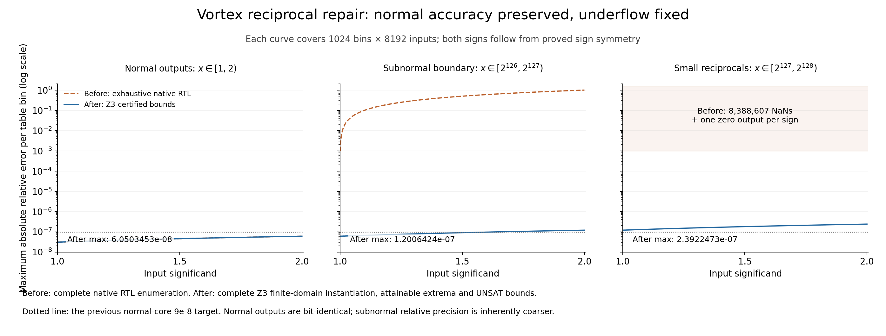
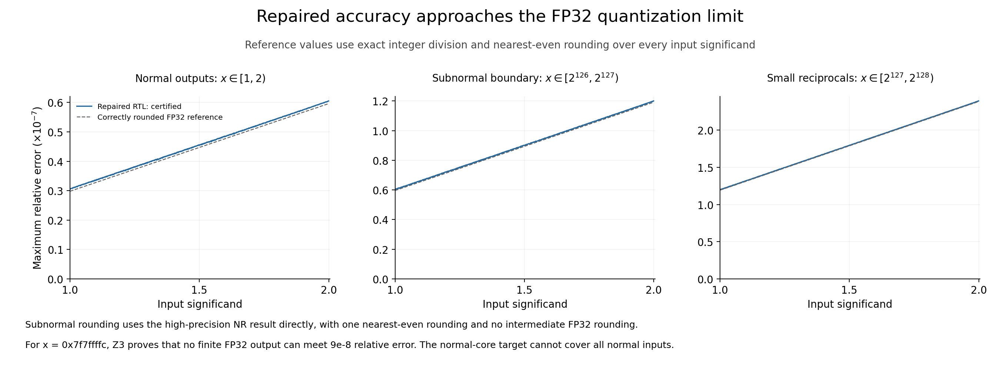

# Vortex DSP_SEED 倒数：次正规输出修复与精度验证

本工程修复 `VX_rtu_recip` 的输出次正规数处理和指数回绕。原始代码与修复版分开保存、分开编译；正常结果位模式、五沿流水线对应关系及输入特殊值策略保持。

## 已验证结果

相对误差定义为精确实数上的 `|x*y−1|`，不是 FP32 再乘一次得到的近似值。

| 输入区域（两种符号） | 修复前 | 修复后严格最大相对误差 | 精确倒数正确舍入的 FP32 参考 |
|---|---:|---:|---:|
| `2^-126 <= |x| <= 2^126` | `6.0503452914e-8` | **`266097/2^42 ≈ 6.0503452914e-8`**，结果逐位保持 | 约 `5.9604637670e-8` |
| `2^126 < |x| < 2^127` | 接近 100% 误差 | **`4224385/2^45 ≈ 1.2006424299e-7`** | 约 `1.1920926113e-7` |
| `2^127 <= |x| < 2^128` | 每个符号 8,388,607 个 NaN、1 个零 | **`2104243/2^43 ≈ 2.3922473247e-7`**，全部有限非零 | 约 `2.3841846541e-7` |

因此，对**所有有限正规 FP32 输入**（偏置指数 1..254，共 4,261,412,864 个有符号位模式），修复版的精确全域最坏相对误差为 `2104243/2^43`，可以达到。见证为输入 `0x7f7fe976`，输出 `0x002002d2`。

零和次正规**输入**仍按 RTU 原先明示策略返回正 FLT_MAX；该策略不等同于数学倒数，未把它混入上述保证。Inf→有符号零、NaN→规范 quiet NaN 的策略也保持。修复对象是倒数落入次正规数范围时的**输出**处理。

## 补丁改变了什么

补丁：[VX_rtu_recip-subnormal-fix.patch](VX_rtu_recip-subnormal-fix.patch)。原始与修复源码位于 `source/original/` 和 `source/fixed/`，基于 Vortex `127178d6375c3cb525e2c8af0c77b5f2d52ed93e`。

1. 将中间指数计算改为有符号数，避免把负值截成指数全 1。
2. 对输入偏置指数 E=253/254，从尚未转换为 FP32 的 Q1.31 Newton–Raphson 结果直接构造次正规尾数：`M=RN-even(y2*2^(245−E))`，即分别右移 8/9 位。
3. 使用 guard、sticky 和保留位奇偶执行一次 nearest-even 舍入，保留完整进位。`M=2^23` 自然编码成最小正规数。
4. 保留 E<=252 的原有路径、参数、端口和流水线级数。没有把完整除法器或软件参考值塞入输出。

先舍入为普通 FP32、再右移可能造成双重舍入，因此本补丁直接使用高精度 y2。

典型回归例：

| 输入 | 原始结果 | 修复结果 |
|---|---|---|
| `0x7ec00000 = 1.5*2^126` | `0x002aaaab`，约 50% 误差 | `0x00555555` |
| `0x7f400000 = 1.5*2^127` | `0x7faaaaab`，NaN | `0x002aaaab` |
| `0x7f000000 = 2^127` | 零 | `0x00400000 = 2^-127` |

## 为什么修复后全域上界超过 9e-8

输出次正规数的绝对间距固定为 2^-149，因此倒数越小，相对间距越大。即使使用精确倒数正确舍入，最后一个区域的最坏相对误差也约为 `2.384e-7`。

对输入 `0x7f7ffffc`，Z3 分别检查正次正规、正正规和非正输出三类，证明**不存在任何有限 FP32 输出**可以满足 `9e-8` 相对误差。因而 `9e-8` 不能作为覆盖全部正规输入的硬约束。修复版的全域最坏误差只比正确舍入参考的全域最坏值高约 0.34%；这不是“每个输入都正确舍入”的保证。

## 证明与仿真

- 原始与修复 RTL 均由 Yosys/slang 转为状态转移关系；输出函数与五沿展开关系在全部 32 位输入上等价，UNSAT。
- 对 E=127、253、254 各自的全部 2^23 个正输入尾数，分为 1024 个区间，每区间完整实例化 8192 个输入。共 **3072 个证书、25,165,824 个精确输入实例**。这是完整有限域实例化，不是采样，也不宣称 Optimize 避免了枚举。
- 每个区间检查越界不存在性 UNSAT、端点 SAT 和覆盖；保留精确整数误差及输出数据。所有区域使用共同分母 2^47，52 位中间误差可无损容纳所有相关值。
- 指数推广与符号对称性覆盖全部有限正规输入；特殊输入策略逐位等价。正常路径逐位保持为 UNSAT 的全域检查。
- 对从真实修复 RTL 导出的打包切点，证明任意 32 位 y2、两种符号下的次正规转换满足最近距离和偶数舍入约束，UNSAT。该性质不以 Newton–Raphson 的典型数值为前提。
- 原始/修复版、三个指数域合计 **50,331,648 个原生 RTL 输入回放**；修复版 25,165,824 个输出全部与 Z3 精确实例逐位一致。
- 另有 29,700 个带符号/指数/边界及极值见证回放，并在原始展开转移关系上检查关键输入的 SAT 可达到性和 UNSAT 输出唯一性。
- 任意逐拍变化输入的五沿流水线对应关系通过；enable=1、mask=1。没有声称覆盖所有停顿/复位协议。
- **9253 个证书查询使用 Z3 CLI 4.15.5 重放，全部通过**；生成端使用 Z3 Python 4.15.4.0。

固定输入/字段与字节数组比较都不使用 FP64 近似参考。正确舍入参考由精确整数除法、余数和 nearest-even tie 规则生成。

## 精度图





第一张图对比原生原版的完整误差包络与修复后的严格界，NaN 单独标明。第二张图对比修复版与精确正确舍入的 FP32 参考，说明次正规相对间距的限制。图也提供 PDF、SVG；图中的浮点数仅用于显示，底层结果保留精确整数/分数。

## 复现

需要 Python、Z3 Python 4.15.4.0、NumPy、Matplotlib。完整重建还需要带 slang 前端的 Yosys 和 Verilator；实验使用 OSS CAD Suite 2026-11-09。

```bash
python3 -m venv .venv
. .venv/bin/activate
pip install -r requirements.txt

# 快速检查：验证已发布模型与源码摘要匹配，再重跑全输入位级/舍入性质。
python3 scripts/quickcheck.py

# 单个查表区间的完整 8192 输入验证。
python3 scripts/bounds.py --exponent 254 --index 1023

# 使用已提供的预处理源码快照重建，无需私有集群目录。
python3 scripts/run_experiment.py --preprocessed --tools /path/to/oss-cad-suite/bin --workers 16
python3 scripts/semantics.py
python3 scripts/pipeline_check.py --root variants/fixed
python3 scripts/analyse.py
python3 scripts/quantization.py
python3 scripts/probes.py
python3 scripts/audit.py --z3 /path/to/oss-cad-suite/bin/z3
python3 scripts/plot.py
```

也可以用 `scripts/build.py --lab LAB_DIRECTORY` 从固定的 Vortex 源码目录构建，布局为 `src/vortex/`、`build/vortex/hw/`、`tools/oss-cad-suite/`。预处理快照重建已与原源码构建进行原生输出对照。

Git 仓库存放源码、补丁、脚本、预处理快照、符号模型、精确区间摘要、关键小型查询与精度图。大型逐输入数组、全部展开证书和编译产物由脚本生成，不放入 Git 历史。完整数组仍保留在实验数据目录，轻量结果文件不冒充完整展开证明对象。

`results/summary.json` 为精确汇总，`results/certified-bounds.csv` 为全部区间的精确上下界，`results/audit-summary.json` 记录重放状态。旧的四项点积全局证明不属于本修复的认证范围。

## 范围与限制

本轮验证固定提交和 DSP_SEED 后端；不代表整个 GPU、完整 RTU 调度协议或物理故障验证。五沿功能关系不等于完成了频率、面积或功耗评估；尚未运行布局布线/PPA。需信任 HDL 转换、Z3 重写/求解和完整有限域展开脚本，没有提供独立小型内核检查的证明对象。

Vortex RTL 保留原始 Apache-2.0 声明与许可证，修复文件明确在该原始文件上修改。
